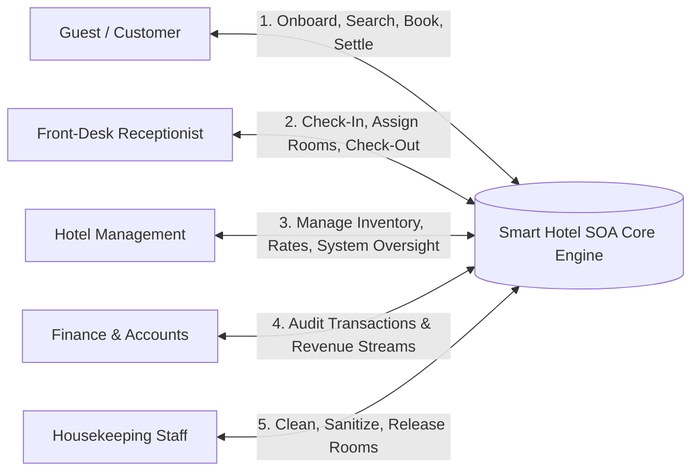
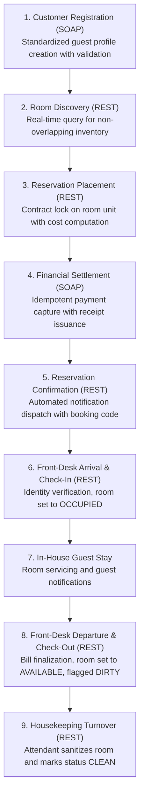

# Business Model Specification
## Smart Hotel Management System (SOA)

---

### 1. Executive Overview & Hospitality Value Proposition
The hospitality industry requires flawless orchestration between guest-facing discovery channels, reservation engines, secure financial settlement, front-desk arrival operations, and back-of-house room turnover. The Smart Hotel Management System leverages Service-Oriented Architecture (SOA) to replace fragmented legacy hotel workflows with synchronized, interoperable service interactions.

---

### 2. Comprehensive Stakeholder Interaction Model

---

### 3. End-to-End Hospitality Value Chain

---

### 4. Measurable Business Value Drivers

1. **Elimination of Overbooking & Date Conflicts:**
   * *Problem:* Manual front-desk logs frequently double-book rooms during peak tourism seasons.
   * *SOA Solution:* The algorithmic date-overlap engine (`existingCheckIn < newCheckOut AND existingCheckOut > newCheckIn`) guarantees transactional room locking.

2. **Decoupled Financial Security via Standardized SOAP:**
   * *Problem:* Insecure or inconsistent payment integrations across varying sales channels.
   * *SOA Solution:* The Payment SOAP Service enforces a rigid XSD contract, prevents duplicate transactions for the same reservation, and generates immutable audit receipt numbers.

3. **Optimized Room Turnover Velocity:**
   * *Problem:* Delays between guest departure and room cleaning create lost revenue hours.
   * *SOA Solution:* The checkout event immediately transitions the room record to `DIRTY` in the Housekeeping Service, alerting attendants in real-time.

4. **Multi-Channel Scalability (Interoperability):**
   * *Problem:* Upgrading web UI or integrating external OTAs (Expedia, Booking.com) normally breaks monolithic backends.
   * *SOA Solution:* Services communicate via standard HTTP/JSON and HTTP/XML; new frontends, kiosks, or partner systems integrate without backend code modifications.

5. **Operational Auditability & Transparency:**
   * *Problem:* Disputed billing and unrecorded complimentary stays.
   * *SOA Solution:* Every check-in, check-out, and transaction captures the acting staff member (`receptionistName`) and timestamp.
