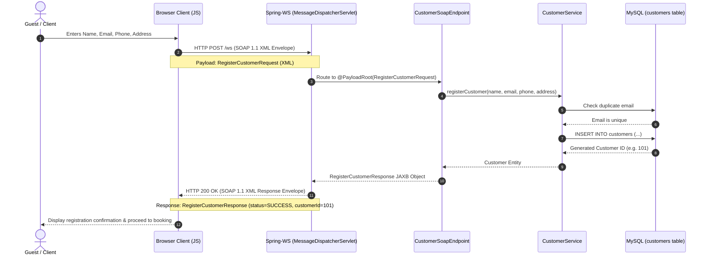
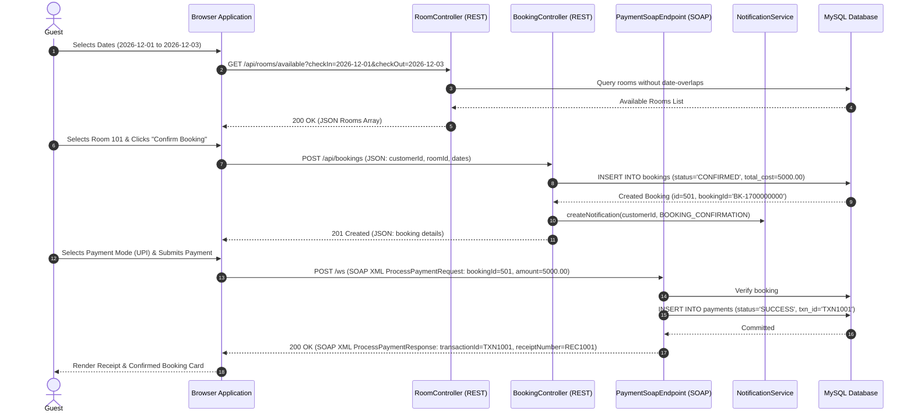
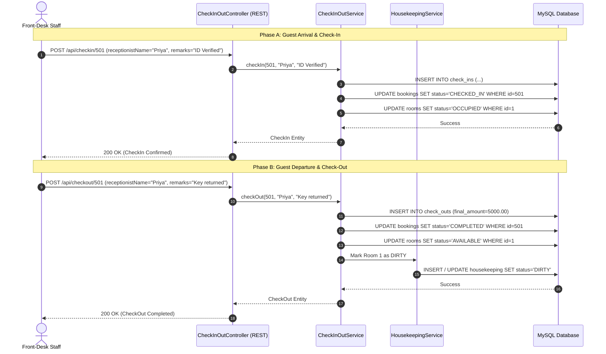

# Service Communication Workflows
## Protocol Integration: SOAP 1.1 XML & REST JSON

---

### Workflow 1: Customer Registration via SOAP 1.1 Web Service

#### Description
A new customer submits demographic onboarding details. The client serializes the data into a valid SOAP 1.1 XML envelope matching the target namespace `http://hotel.com/soap/customer`. The Spring-WS `MessageDispatcherServlet` validates the payload against `customer.xsd` and executes transactional persistence in MySQL.

#### Sequence Diagram



#### Actual Wire Payloads (SOAP 1.1 XML)

##### Request XML:
```xml
POST /ws HTTP/1.1
Host: localhost:8080
Content-Type: text/xml;charset=UTF-8
SOAPAction: ""

<soapenv:Envelope xmlns:soapenv="http://schemas.xmlsoap.org/soap/envelope/"
                  xmlns:cus="http://hotel.com/soap/customer">
    <soapenv:Header/>
    <soapenv:Body>
        <cus:RegisterCustomerRequest>
            <cus:name>Rahul Sharma</cus:name>
            <cus:email>rahul@gmail.com</cus:email>
            <cus:phone>9876543210</cus:phone>
            <cus:address>Chennai, India</cus:address>
        </cus:RegisterCustomerRequest>
    </soapenv:Body>
</soapenv:Envelope>
```

##### Response XML:
```xml
HTTP/1.1 200 OK
Content-Type: text/xml;charset=UTF-8

<SOAP-ENV:Envelope xmlns:SOAP-ENV="http://schemas.xmlsoap.org/soap/envelope/">
    <SOAP-ENV:Header/>
    <SOAP-ENV:Body>
        <ns2:RegisterCustomerResponse xmlns:ns2="http://hotel.com/soap/customer">
            <ns2:customerId>101</ns2:customerId>
            <ns2:status>SUCCESS</ns2:status>
            <ns2:message>Customer registered successfully</ns2:message>
        </ns2:RegisterCustomerResponse>
    </SOAP-ENV:Body>
</SOAP-ENV:Envelope>
```

---

### Workflow 2: Room Booking (REST JSON) & Payment Processing (SOAP XML)

#### Description
This composite workflow showcases dual-protocol coordination:
1. REST JSON for room availability discovery and booking placement.
2. SOAP XML for secure simulated payment settlement.
3. Event notification dispatch upon completion.

#### Sequence Diagram



#### Actual Payloads

##### Booking Placement Request (REST JSON):
```json
POST /api/bookings HTTP/1.1
Content-Type: application/json

{
  "customerId": 101,
  "roomId": 1,
  "checkInDate": "2026-12-01",
  "checkOutDate": "2026-12-03"
}
```

##### Booking Placement Response (REST JSON):
```json
HTTP/1.1 201 Created
Content-Type: application/json

{
  "status": 201,
  "message": "Booking created successfully",
  "data": {
    "id": 501,
    "bookingId": "BK-1700000000123",
    "customer": { "id": 101, "name": "Rahul Sharma" },
    "room": { "id": 1, "roomNumber": "101", "price": 2500.00 },
    "checkInDate": "2026-12-01",
    "checkOutDate": "2026-12-03",
    "totalCost": 5000.00,
    "status": "CONFIRMED"
  }
}
```

##### Payment Request (SOAP 1.1 XML):
```xml
POST /ws HTTP/1.1
Content-Type: text/xml;charset=UTF-8

<soapenv:Envelope xmlns:soapenv="http://schemas.xmlsoap.org/soap/envelope/"
                  xmlns:pay="http://hotel.com/soap/payment">
    <soapenv:Header/>
    <soapenv:Body>
        <pay:ProcessPaymentRequest>
            <pay:bookingId>501</pay:bookingId>
            <pay:customerId>101</pay:customerId>
            <pay:amount>5000.00</pay:amount>
            <pay:paymentMode>UPI</pay:paymentMode>
        </pay:ProcessPaymentRequest>
    </soapenv:Body>
</soapenv:Envelope>
```

##### Payment Response (SOAP 1.1 XML):
```xml
HTTP/1.1 200 OK
Content-Type: text/xml;charset=UTF-8

<SOAP-ENV:Envelope xmlns:SOAP-ENV="http://schemas.xmlsoap.org/soap/envelope/">
    <SOAP-ENV:Header/>
    <SOAP-ENV:Body>
        <ns2:ProcessPaymentResponse xmlns:ns2="http://hotel.com/soap/payment">
            <ns2:transactionId>TXN1700000000999</ns2:transactionId>
            <ns2:status>SUCCESS</ns2:status>
            <ns2:message>Payment processed successfully</ns2:message>
            <ns2:receiptNumber>REC1700000000999</ns2:receiptNumber>
        </ns2:ProcessPaymentResponse>
    </SOAP-ENV:Body>
</SOAP-ENV:Envelope>
```

---

### Workflow 3: Check-In, Check-Out & Housekeeping Operations (REST JSON)

#### Sequence Diagram


