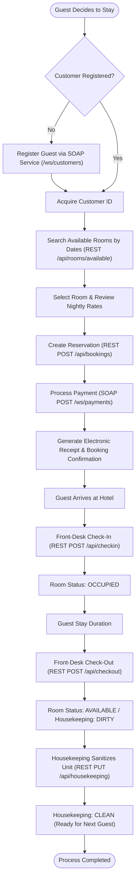
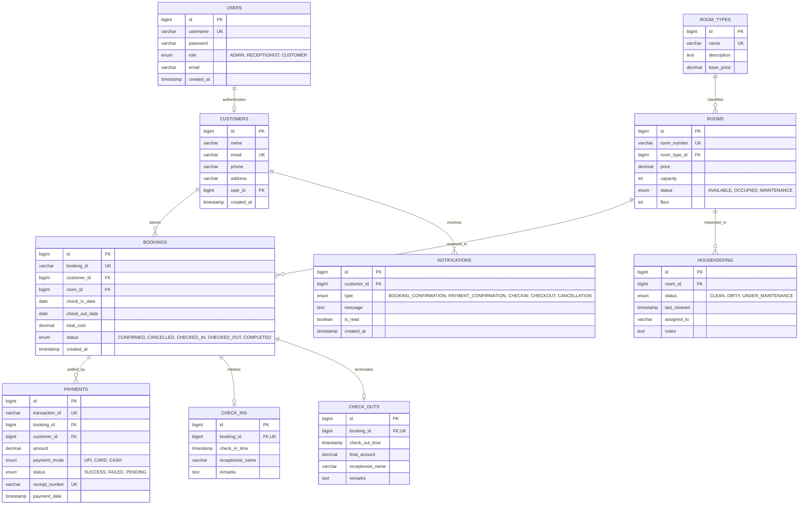
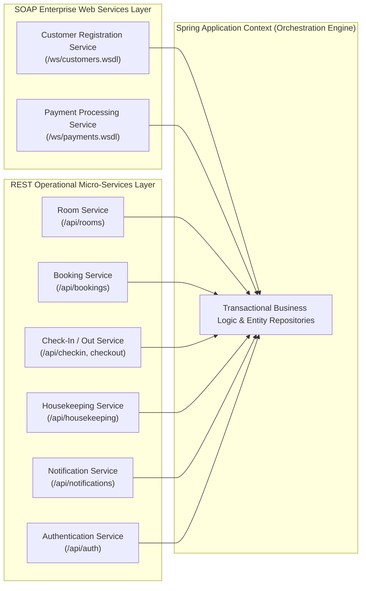
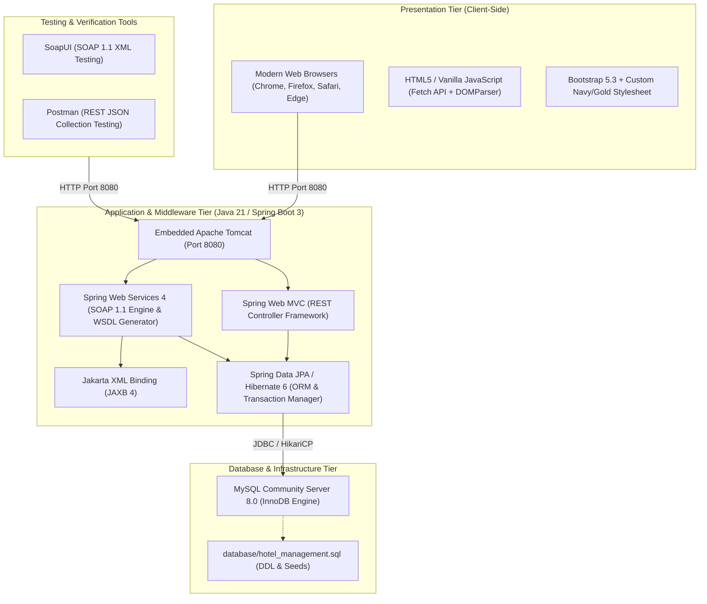

# Enterprise Architecture (EA) Specification
## Smart Hotel Management System (SOA)

---

### Layer 1: Business Architecture

#### 1. Stakeholder Ecosystem
* **Hotel Administrator:** Configures room inventory, pricing rules, user roles, and monitors macro performance.
* **Front-Desk Receptionist:** Executes check-in, verifies identity, assigns key cards, and conducts check-out billing.
* **Customer / Guest:** Onboards into the system, explores rooms, completes reservations, and pays via secure gateway.
* **Accounts & Finance Department:** Reconciles transaction logs, monitors revenue, and reviews payment receipts.
* **Housekeeping Staff:** Inspects and sanitizes rooms, updating status from `DIRTY` to `CLEAN`.

#### 2. Business Process Workflow Diagram

---

### Layer 2: Data Architecture

#### 1. Database Normalization & Integrity
The data tier is deployed on a relational MySQL 8 schema normalized to Third Normal Form (3NF). Primary key surrogate sequences (`BIGINT AUTO_INCREMENT`), foreign key references (`ON DELETE RESTRICT`), unique indexes, and enumerated domain columns guarantee referential integrity.

#### 2. Enterprise Relational ER Diagram

---

### Layer 3: Application Architecture

The application tier is partitioned into 8 modular service units exposed via standardized interfaces:

---

### Layer 4: Technology Architecture

#### Technology Stack Justification
* **Java 21 LTS:** Provides virtual thread capability, modern pattern matching, and long-term enterprise platform stability.
* **Spring Boot 3.2.1:** Simplifies dependency management and application lifecycle management.
* **Spring-WS 4.0.10:** Industry benchmark for Contract-First SOAP web service development and WSDL publication.
* **MySQL 8:** Enterprise-ready ACID transactional guarantees with robust relational indexing.
* **Bootstrap 5:** Fluid responsive presentation without heavyweight framework overhead.
