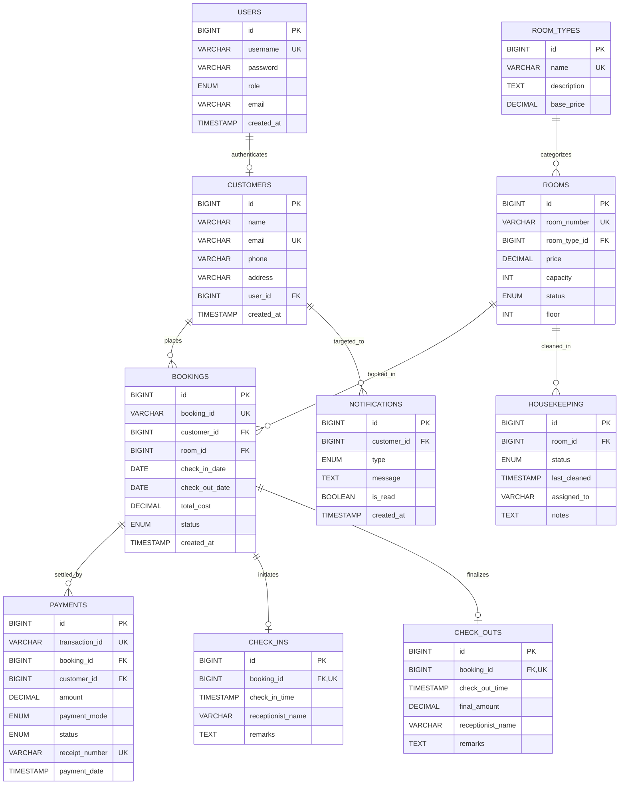

# Relational Database Design & Entity Relationship (ER) Documentation
## Database: `hotel_management`

---

### 1. Database Schema Overview
The database layer is implemented using MySQL 8 InnoDB engine, enforcing foreign key referential integrity, UTF-8 unicode encoding, and ACID transaction safety.

---

### 2. Comprehensive Table Definitions

#### 1. `users` Table
Stores authentication credentials and RBAC authorization roles.
* `id` BIGINT AUTO_INCREMENT PRIMARY KEY
* `username` VARCHAR(50) NOT NULL UNIQUE
* `password` VARCHAR(255) NOT NULL
* `role` ENUM('ADMIN', 'RECEPTIONIST', 'CUSTOMER') NOT NULL
* `email` VARCHAR(100) NULL
* `created_at` TIMESTAMP DEFAULT CURRENT_TIMESTAMP

#### 2. `customers` Table
Guest demographic records (populated via Customer SOAP Web Service).
* `id` BIGINT AUTO_INCREMENT PRIMARY KEY
* `name` VARCHAR(100) NOT NULL
* `email` VARCHAR(100) NOT NULL UNIQUE
* `phone` VARCHAR(15) NOT NULL
* `address` VARCHAR(255) NULL
* `user_id` BIGINT NULL, FOREIGN KEY REFERENCES `users(id)`
* `created_at` TIMESTAMP DEFAULT CURRENT_TIMESTAMP

#### 3. `room_types` Table
Defines luxury classifications and benchmark baseline rates.
* `id` BIGINT AUTO_INCREMENT PRIMARY KEY
* `name` VARCHAR(50) NOT NULL UNIQUE (e.g. SINGLE, DOUBLE, DELUXE, SUITE)
* `description` TEXT NULL
* `base_price` DECIMAL(10,2) NOT NULL

#### 4. `rooms` Table
Inventory units for guest lodging.
* `id` BIGINT AUTO_INCREMENT PRIMARY KEY
* `room_number` VARCHAR(10) NOT NULL UNIQUE
* `room_type_id` BIGINT NOT NULL, FOREIGN KEY REFERENCES `room_types(id)`
* `price` DECIMAL(10,2) NOT NULL
* `capacity` INT NOT NULL DEFAULT 2
* `status` ENUM('AVAILABLE', 'OCCUPIED', 'MAINTENANCE') DEFAULT 'AVAILABLE'
* `floor` INT NOT NULL DEFAULT 1

#### 5. `bookings` Table
Central reservation contracts linking guests, rooms, and calendar intervals.
* `id` BIGINT AUTO_INCREMENT PRIMARY KEY
* `booking_id` VARCHAR(20) NOT NULL UNIQUE
* `customer_id` BIGINT NOT NULL, FOREIGN KEY REFERENCES `customers(id)`
* `room_id` BIGINT NOT NULL, FOREIGN KEY REFERENCES `rooms(id)`
* `check_in_date` DATE NOT NULL
* `check_out_date` DATE NOT NULL
* `total_cost` DECIMAL(10,2) NOT NULL
* `status` ENUM('CONFIRMED', 'CANCELLED', 'CHECKED_IN', 'CHECKED_OUT', 'COMPLETED') DEFAULT 'CONFIRMED'
* `created_at` TIMESTAMP DEFAULT CURRENT_TIMESTAMP

#### 6. `payments` Table
Audit logs of financial settlements (populated via Payment SOAP Web Service).
* `id` BIGINT AUTO_INCREMENT PRIMARY KEY
* `transaction_id` VARCHAR(30) NOT NULL UNIQUE
* `booking_id` BIGINT NOT NULL, FOREIGN KEY REFERENCES `bookings(id)`
* `customer_id` BIGINT NOT NULL, FOREIGN KEY REFERENCES `customers(id)`
* `amount` DECIMAL(10,2) NOT NULL
* `payment_mode` ENUM('UPI', 'CARD', 'CASH') NOT NULL
* `status` ENUM('SUCCESS', 'FAILED', 'PENDING') DEFAULT 'PENDING'
* `receipt_number` VARCHAR(30) NULL UNIQUE
* `payment_date` TIMESTAMP DEFAULT CURRENT_TIMESTAMP

#### 7. `check_ins` Table
Tracks physical arrival of guests.
* `id` BIGINT AUTO_INCREMENT PRIMARY KEY
* `booking_id` BIGINT NOT NULL UNIQUE, FOREIGN KEY REFERENCES `bookings(id)`
* `check_in_time` TIMESTAMP NOT NULL DEFAULT CURRENT_TIMESTAMP
* `receptionist_name` VARCHAR(100) NULL
* `remarks` TEXT NULL

#### 8. `check_outs` Table
Tracks guest departures and bill closure.
* `id` BIGINT AUTO_INCREMENT PRIMARY KEY
* `booking_id` BIGINT NOT NULL UNIQUE, FOREIGN KEY REFERENCES `bookings(id)`
* `check_out_time` TIMESTAMP NOT NULL DEFAULT CURRENT_TIMESTAMP
* `final_amount` DECIMAL(10,2) NOT NULL
* `receptionist_name` VARCHAR(100) NULL
* `remarks` TEXT NULL

#### 9. `housekeeping` Table
Hygiene and sanitization lifecycle tracking for each room.
* `id` BIGINT AUTO_INCREMENT PRIMARY KEY
* `room_id` BIGINT NOT NULL, FOREIGN KEY REFERENCES `rooms(id)`
* `status` ENUM('CLEAN', 'DIRTY', 'UNDER_MAINTENANCE') DEFAULT 'CLEAN'
* `last_cleaned` TIMESTAMP NULL
* `assigned_to` VARCHAR(100) NULL
* `notes` TEXT NULL

#### 10. `notifications` Table
Dispatched alerts notifying customers of booking, payment, and stay events.
* `id` BIGINT AUTO_INCREMENT PRIMARY KEY
* `customer_id` BIGINT NOT NULL, FOREIGN KEY REFERENCES `customers(id)`
* `type` ENUM('BOOKING_CONFIRMATION', 'PAYMENT_CONFIRMATION', 'CHECKIN', 'CHECKOUT', 'CANCELLATION') NOT NULL
* `message` TEXT NOT NULL
* `is_read` BOOLEAN DEFAULT FALSE
* `created_at` TIMESTAMP DEFAULT CURRENT_TIMESTAMP
