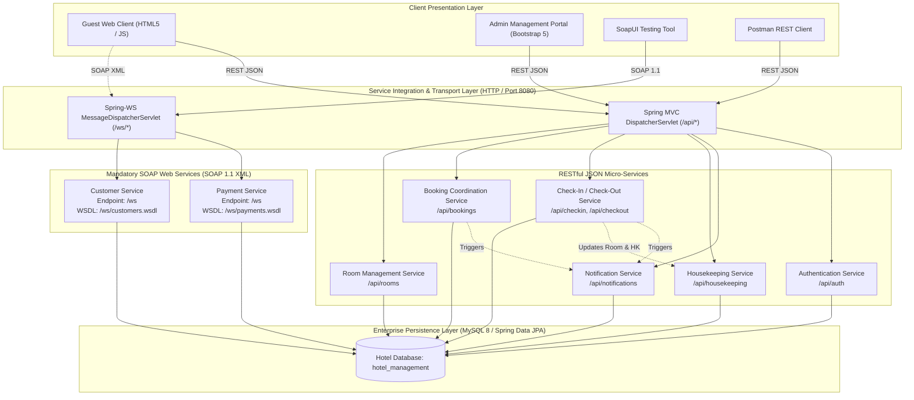

# Service-Oriented Architecture (SOA) Design Document
## Smart Hotel Management System

---

### 1. Introduction & SOA Principles Applied
The Smart Hotel Management System decomposes complex hotel operations into autonomous, discoverable, loosely coupled, and reusable software services. The architecture applies six foundational SOA principles:

1. **Standardized Service Contract:** All services adhere to explicit communication agreements. The SOAP services publish formal WSDL contracts backed by XML Schema Definitions (`.xsd`), while REST APIs publish standardized JSON schemas.
2. **Service Loose Coupling:** Services encapsulate their implementation logic, interacting solely through well-defined protocol messages without direct internal class coupling.
3. **Service Abstraction:** Consumers interact with services via HTTP endpoints (`/ws`, `/api/*`) without knowledge of underlying database schemas or JPA entities.
4. **Service Reusability:** Services such as `CustomerService`, `NotificationService`, and `PaymentService` operate as shared enterprise capabilities consumable by front-office web clients, mobile apps, or third-party travel aggregators.
5. **Service Autonomy:** Each service controls its domain logic, state validation, and operational data integrity constraints.
6. **Service Composability:** Composite workflows (such as Booking + Payment + Notification) aggregate multiple fine-grained services into coordinated business processes.

---

### 2. Service Architecture Diagram

---

### 3. Comprehensive Service Catalog

#### A. SOAP Web Services (Contract-First / XML)

##### 1. Customer Registration Service
* **Transport URL:** `http://localhost:8080/ws`
* **WSDL Location:** `http://localhost:8080/ws/customers.wsdl`
* **Namespace:** `http://hotel.com/soap/customer`
* **Port Type:** `CustomerPort`
* **Operations:**
  * `RegisterCustomerRequest`: Ingests `name`, `email`, `phone`, `address`. Returns `customerId`, `status`, `message`.
  * `GetCustomerDetailsRequest`: Ingests `customerId`. Returns full customer demographic record.
* **Protocol & Standards:** SOAP 1.1, WS-I Basic Profile 1.1, XSD 1.0.

##### 2. Payment Processing Service
* **Transport URL:** `http://localhost:8080/ws`
* **WSDL Location:** `http://localhost:8080/ws/payments.wsdl`
* **Namespace:** `http://hotel.com/soap/payment`
* **Port Type:** `PaymentPort`
* **Operations:**
  * `ProcessPaymentRequest`: Ingests `bookingId`, `customerId`, `amount`, `paymentMode` (`UPI`/`CARD`/`CASH`). Validates booking existence and returns `transactionId`, `receiptNumber`, `status`, `message`.
  * `GetPaymentDetailsRequest`: Ingests `transactionId`. Returns transaction record including financial settlement status and audit timestamp.

---

#### B. RESTful JSON Services

| Service Name | Base Endpoint | HTTP Method | Operation | Consumes / Produces |
|---|---|---|---|---|
| **Room Service** | `/api/rooms` | `GET` | List all hotel rooms | `-` / `application/json` |
| | `/api/rooms/available` | `GET` | Filter rooms by date overlap | Params / `application/json` |
| | `/api/rooms` | `POST` | Create new room record | `application/json` / `application/json` |
| | `/api/rooms/{id}` | `PUT` | Update room attributes or state | `application/json` / `application/json` |
| | `/api/rooms/types` | `GET` | List room classifications | `-` / `application/json` |
| **Booking Service** | `/api/bookings` | `POST` | Reserve room for customer | `application/json` / `application/json` |
| | `/api/bookings` | `GET` | Retrieve all bookings | `-` / `application/json` |
| | `/api/bookings/{id}` | `GET` | Retrieve booking details | `-` / `application/json` |
| | `/api/bookings/customer/{id}`| `GET` | Customer booking history | `-` / `application/json` |
| | `/api/bookings/{id}/cancel` | `PUT` | Cancel reservation | `-` / `application/json` |
| **Front Desk Service**| `/api/checkin/{id}` | `POST` | Check-in guest | `application/json` / `application/json` |
| | `/api/checkout/{id}`| `POST` | Check-out guest & trigger HK | `application/json` / `application/json` |
| | `/api/checkins` | `GET` | Check-in operational logs | `-` / `application/json` |
| | `/api/checkouts` | `GET` | Check-out operational logs | `-` / `application/json` |
| **Housekeeping** | `/api/housekeeping` | `GET` | Cleaning status for all units| `-` / `application/json` |
| | `/api/housekeeping/{id}`| `PUT`| Update room hygiene status | `application/json` / `application/json` |
| **Notifications** | `/api/notifications/{id}`| `GET`| Retrieve guest notifications| `-` / `application/json` |
| | `/api/notifications` | `GET` | Retrieve all system alerts | `-` / `application/json` |
| **Authentication** | `/api/auth/login` | `POST` | User login & role discovery | `application/json` / `application/json` |

---

### 4. SOAP vs. REST Architectural Comparison

| Dimension | SOAP 1.1 Web Services (Customer & Payment) | RESTful APIs (Rooms, Bookings, Operations) |
|---|---|---|
| **Underlying Standard** | W3C Recommendation / WS-I Profiles | Architectural Style (Fielding Dissertation) |
| **Contract Mechanism** | Strict WSDL & XSD Schema validation | JSON Schemas / URI conventions |
| **Data Format** | Extensible Markup Language (XML) | JavaScript Object Notation (JSON) |
| **Transport** | HTTP POST (acts as transport envelope) | Native HTTP Verbs (GET, POST, PUT, DELETE) |
| **State Handling** | Operation-oriented / RPC style | Resource-oriented / State representation |
| **Error Handling** | SOAP Faults / Structured XML elements | Standard HTTP Status Codes (200, 201, 400, 404) |
| **Ideal Use Case** | Formal enterprise transactions (Registrations, Payments) | High-concurrency CRUD & dynamic UI feeds |
